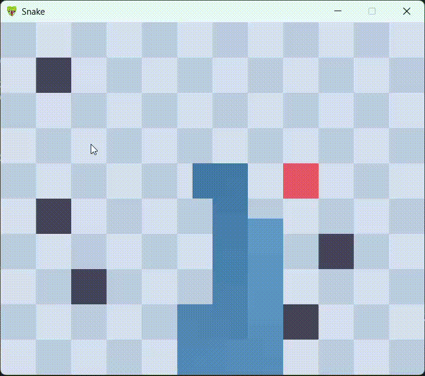
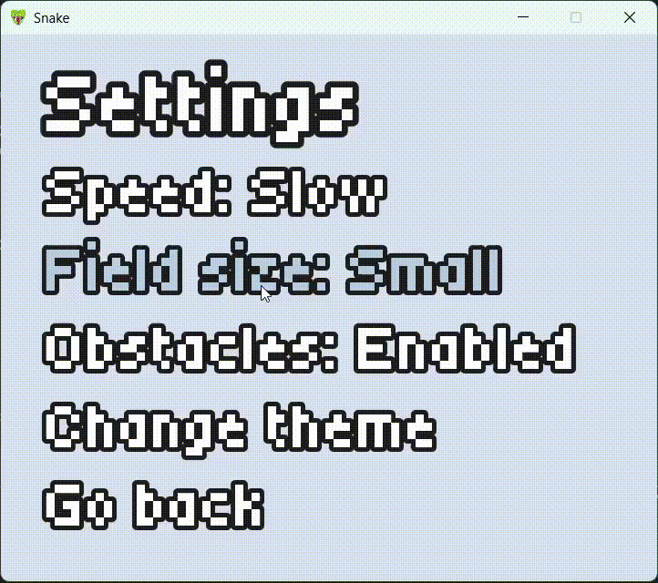
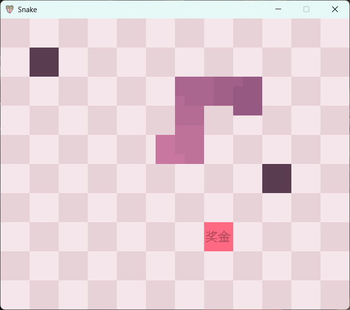
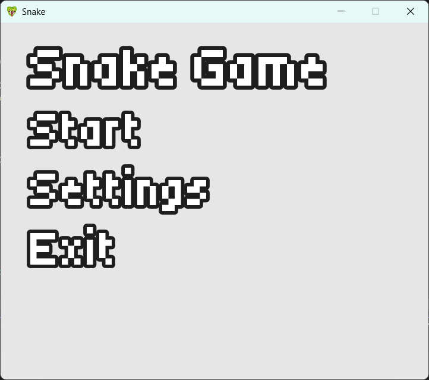
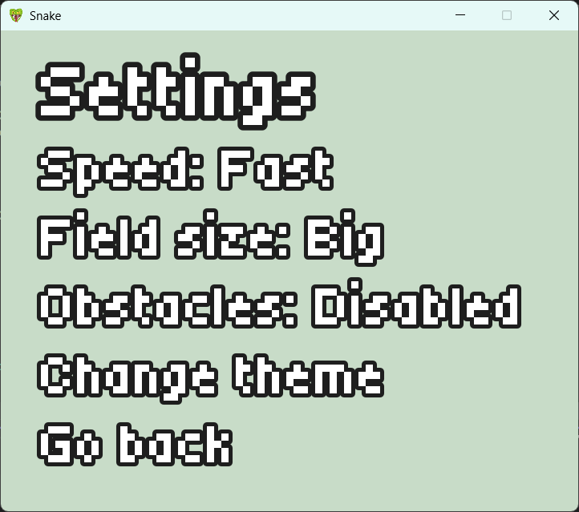
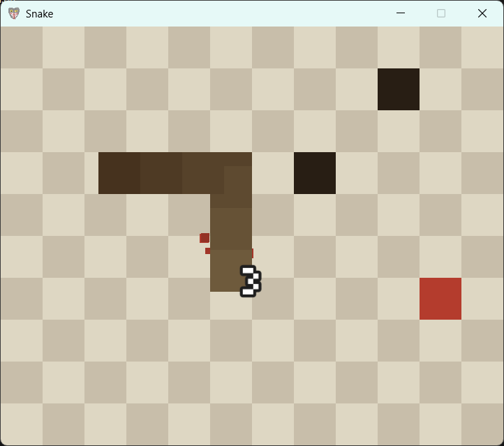

# SnakeGame (SFML 3.1.X)
Modern C++17 implementation of classic Snake arcade game. Lightweight, configurable & portable.

<div align = "center"></div>

## Features
- Standalone executable: No runtime DLLs/shared library dependencies due to static linking;
- Assets embedded directly into the binary via xxd-generated headers;
- Visual effects made using simple shaders, particle system and more;
- Sound effects which make the expirience more enjoyable;
- Difficulty modifier based on player's efficiency;
- Save and Restore system;

## Requirements
- CMake >= 3.22;
- Compiler with C++17 support;
- ***Linux only*** System development libraries for windowing and audio;

> [!NOTE]
> All platform SDKs are included with your compiler toolchain on Windows.
> On linux, install the required development packages listed in the [official SFML documentation](https://www.sfml-dev.org/tutorials/3.1/getting-started/build-from-source/#installing-dependencies).

## Build 
The project uses CMake's `FetchContent`, SFML 3.1.X and its dependencies will be downloaded on build. User needs only to clone the repository.
```bash
git clone https://github.com/Hleblu/Snake-game.git sfmlSnake
cd sfmlSnake
```
Start the CMake build process.
```bash
cmake -B build -DCMAKE_BUILD_TYPE=Release
```
Compile the executable.
```bash
cmake --build build --config Release
```
Compiled executable will be located in <ins>build/Release</ins> directory. Enjoy!
> [!NOTE]
> Output location depends on the generator. Please check the final destination for yourself.

## Preview
<div align="center">
	
	
	<br><br>
	
	
	<br><br>
	
	
</div>

## Important notes
- **Learning project:** This project was developed primarily for learning C++ and SFML.
- **Broken Commit History:** Please do not build commits prior to `[0944915]`. To release this repository publicly, all original assets were scrapped and replaced with CC0 alternatives (which I found better). Therefore older commits are missing the required resources and won't compile.